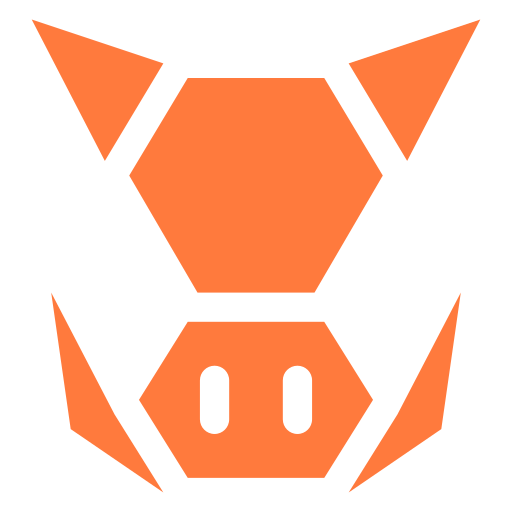

<p align="center">
  
</p>

<h1 align="center">BoarLite</h1>

<p align="center">
  <b>AI that works when the internet doesn't.</b><br />
  A closed, offline Android research assistant: the model and the knowledge ship inside the APK, answers show their sources, and the app has no network permission at all.
</p>

<p align="center">
  
  
  
  <a href="./LICENSE"></a>
</p>

<p align="center">
  <a href="#what-it-is">What it is</a> ·
  <a href="#how-it-answers">How it answers</a> ·
  <a href="#what-it-can-cite">What it can cite</a> ·
  <a href="#install">Install</a> ·
  <a href="#based-on-boar">Based on BOAR</a> ·
  <a href="#docs">Docs</a>
</p>

## What it is

Search and chat assistants stop working the moment you lose signal: on a plane, a
trail, a border crossing, a blackout. BoarLite answers in airplane mode, with no
account, no server and no Google Play Services.

BoarLite is a **closed offline build** (package `team.sopa.boar.lite`): the APK declares no
`INTERNET` permission, so the app itself cannot send anything you ask, read or import over a network. Everything
the app needs is built into the APK (about 3.0 GB) and unpacked on first launch:

- the answer model, **Qwen3 1.7B** (Q4_K_M), the only one: there is no model choice;
- the search (embedding) model, BGE Small;
- **13 knowledge packs** (the "K13 kit") and the prebuilt search index.

It is **English only** and gives **Succinct** answers only: no Deep Research, no Detailed mode,
no length setting.

## How it answers

- **Retrieval is local and hybrid:** SQLite FTS5 keyword search plus on-device embeddings, over
  the packs and over any documents you imported. Inference is `llama.cpp` through JNI.
- **Every answer the model writes shows its sources** and the time it took, and ends with a fixed line:
  *May contain errors; check the source.*
- **Health questions go through a lexical gate** (a word and phrase check, not a model
  judgment). If the search kept no passage from a health pack (first aid, MedlinePlus, Medical
  Sciences Q&A), the app gives a fixed safe text and the emergency number instead of an answer
  from the model's memory; with a health passage kept, the model answers with that passage in its context. Health search
  runs without the extra search port (mode `ON_NO_HEALTH`). Health content is AI-reviewed, not
  clinically reviewed: general information, not medical advice.
- **Follow-ups are free** and keep up to the last three exchanges. There is no long-chat summary.
- **Quick math** (a unit conversion, a percentage or plain arithmetic) is computed directly,
  with no model and no source list. A health question goes through the health gate first; a cold-or-heat
  exposure question that also asks for a conversion gets the computed line with a health passage or the fixed safe text.
- **A short tour** runs while the bundle unpacks on first launch.

## What it can cite

The 13 packs of the K13 kit: Wikipedia Vital Articles, Simple English Wikipedia, Wikivoyage
travel guides, the CIA World Factbook, first aid and emergency, MedlinePlus health topics,
visa requirements, a crypto and Ethereum reference, and five Stack Exchange Q&A sets
(Medical Sciences, Outdoors, Travel, Cooking, Personal finance). The Wikipedia essentials
collections (1,000 and 4,000 topics) and their prebuilt index are bundled too. Each pack
keeps its own license, listed in the app under Settings → About → Credits.

**Your files:** `.txt`, `.md`, `.csv`, `.json` and `.pdf` (selectable text, no OCR) are chunked
and embedded on the phone and stay there. You can export a collection or an evaluation run as a
file through Android's share sheet, but only when you choose to, and the app itself never
sends anything.

## Install

BoarLite is not published on any store and its source repository is private. You get an APK
from the team and install it yourself:

```bash
adb install -r boarlite-release.apk   # or open the file on the phone
```

On first launch the app unpacks the bundle (model, packs, index) behind a short tour; that
needs about 6 GB of free space (the 3 GB APK plus the unpacked copy) and no connection.

**Build from source** (for people with access to the repository): see
[android-native/docs/BUILDING-RELEASE.md](android-native/docs/BUILDING-RELEASE.md) and
[AGENTS.md](AGENTS.md) for the commands.

**Your data:** it stays on the phone, outside cloud backup and device transfer. It is deleted when
you uninstall the app, or from Settings → Start over → Erase everything (every model and pack,
your documents and all chats).

## Based on BOAR

BoarLite is a fork of [BOAR](https://github.com/rferrari/boar-app) (MIT), the open-source
offline research app by its community of contributors. The engine, the pack search design and
much of the UI come from BOAR; BoarLite fixes one model, one language and one answer style, and
removes everything that needs a network. BOAR's own README, release badges, benchmarks and
store or download instructions describe that project, not this build. The MIT license and
copyright notice are in [LICENSE](LICENSE), and third-party credits are in
[android-native/NOTICE](android-native/NOTICE).

## Docs

| | |
|---|---|
| [ARCHITECTURE.md](ARCHITECTURE.md) | Design notes (inherited from BOAR; where it differs, this README and the code win) |
| [android-native/docs/BUILDING-RELEASE.md](android-native/docs/BUILDING-RELEASE.md) | Building a release APK with its data bundle, signing, adb-push install |
| [AGENTS.md](AGENTS.md) | Compile and install from source |
| [PRIVACY.md](PRIVACY.md) · [TERMS.md](TERMS.md) | Privacy notice and terms for BoarLite |
| [SUBMISSION_CHECKLIST.md](SUBMISSION_CHECKLIST.md) | Release and submission checks |

License: [LICENSE](LICENSE).
